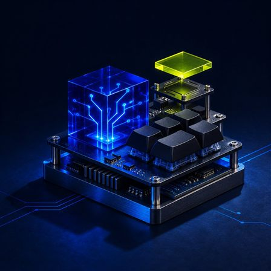

  

<h1 align="center">Laraib Siddiqui</h1>

<strong>Data engineer · Side-project builder</strong>

  <a href="https://github.com/laraib-sidd">Work profile · @laraib-sidd</a>
  &nbsp;·&nbsp;
  <a href="https://github.com/laraibsidd-dev?tab=repositories">Personal repositories</a>

I build data pipelines. My side projects usually start with a question I keep having to answer by hand.

## Selected projects

### [Panel Club](https://panel-club-seven.vercel.app/) · Live

**What should I watch next?** I built a searchable catalog of comedy panel shows and roasts from India and the US. You can find episodes by show, host, or guest and watch through the official player.

### [Deal Hunter](https://github.com/laraib-sidd/deal-hunter) · In development

**Is this used GPU a good deal?** I built a dashboard that collects second-hand hardware listings in India, matches them to a hardware catalog, and scores deals against price history.

### More builds

| Project | What I built |
| --- | --- |
| [JoyScope](https://github.com/laraib-sidd/joyscope) | A browser tool for checking controller buttons, triggers, and stick drift. |
| [GameBrain](https://github.com/laraib-sidd/game-brain) | An experimental framework where language models play games from structured rules and review their matches. |
| [Threadline](https://github.com/laraib-sidd/threadline) | A news-reading demo that puts dated timelines and source notes next to a story. |
| [Khidki](https://github.com/laraib-sidd/khidki) | An on-device Android project for time-limited, user-controlled SMS forwarding. |

## Tools I work with

**Data** &nbsp; <kbd>Python</kbd> <kbd>SQL</kbd> <kbd>Spark</kbd> <kbd>Delta Lake</kbd> <kbd>Airflow</kbd>  
**Side projects** &nbsp; <kbd>TypeScript</kbd> <kbd>Android</kbd> <kbd>SQLite</kbd>

## Off the keyboard

| On the shelf | On repeat |
| --- | --- |
| **Films** · *Memories of Murder*, *Dhol* | **Delhi hip-hop** · Nanku, Seedhe Maut, Raga |
| **Anime and manga** · *Attack on Titan*, *Hunter × Hunter*, *Vinland Saga*, *Vagabond*, *Berserk* | **Tracks** · *Pyar+Tum*, *Nanchaku*, *Midtown Madness*, *Flashing Lights*, *HUMBLE.* |
